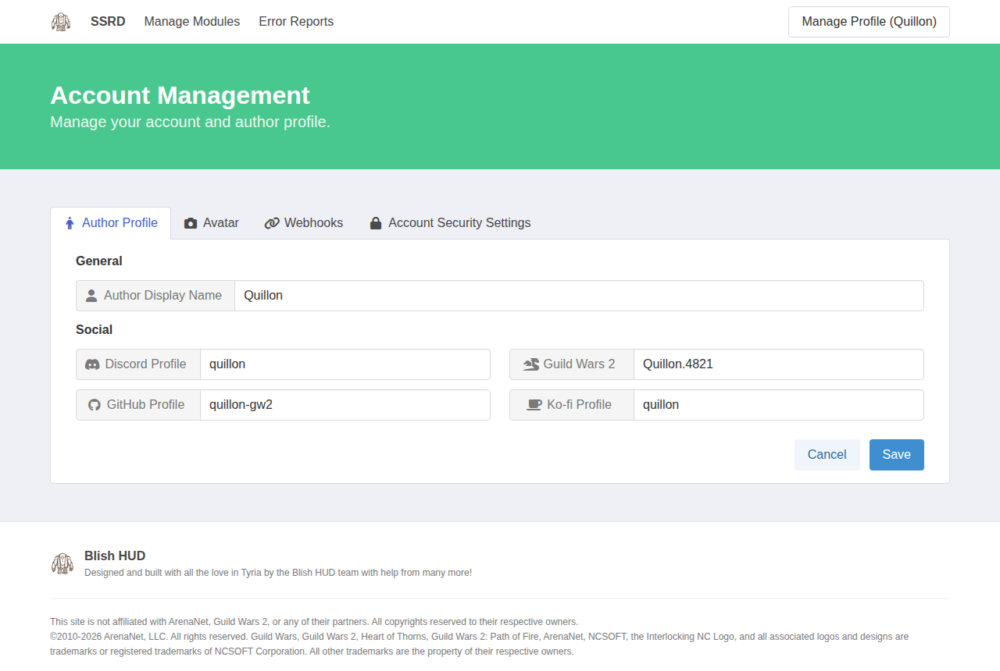

## Overview

Your author profile is shown with your modules on https://blishhud.com/modules. Open it with the **Manage Profile** button in the top right of SSRD.

## Author Profile

- **Author Display Name** is the name shown as your modules' author.
- **Discord**, **GitHub**, **Guild Wars 2** and **Ko-fi** link to your profiles on those sites.

## Avatar

Import your avatar from your GitHub or Discord account, or select **Reset to default**. Imports can take a few minutes to show up.

## Webhooks

Add a webhook URL to **Module Released** to be told each time one of your releases is published. Webhooks are sent in Discord's format, so a Discord channel webhook works as is. If you edit the release notes later, the Discord message is updated to match.

## Account Security Settings

Your password and sign-in settings are managed on the Blish HUD sign-in site. The **Account Security Settings** tab takes you there.
