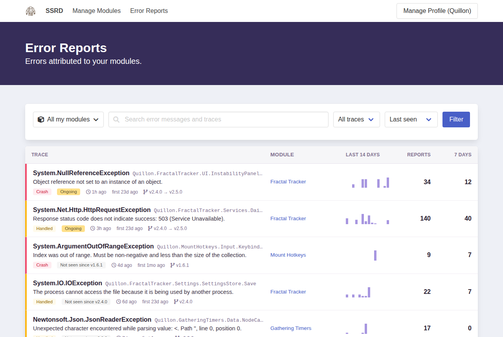
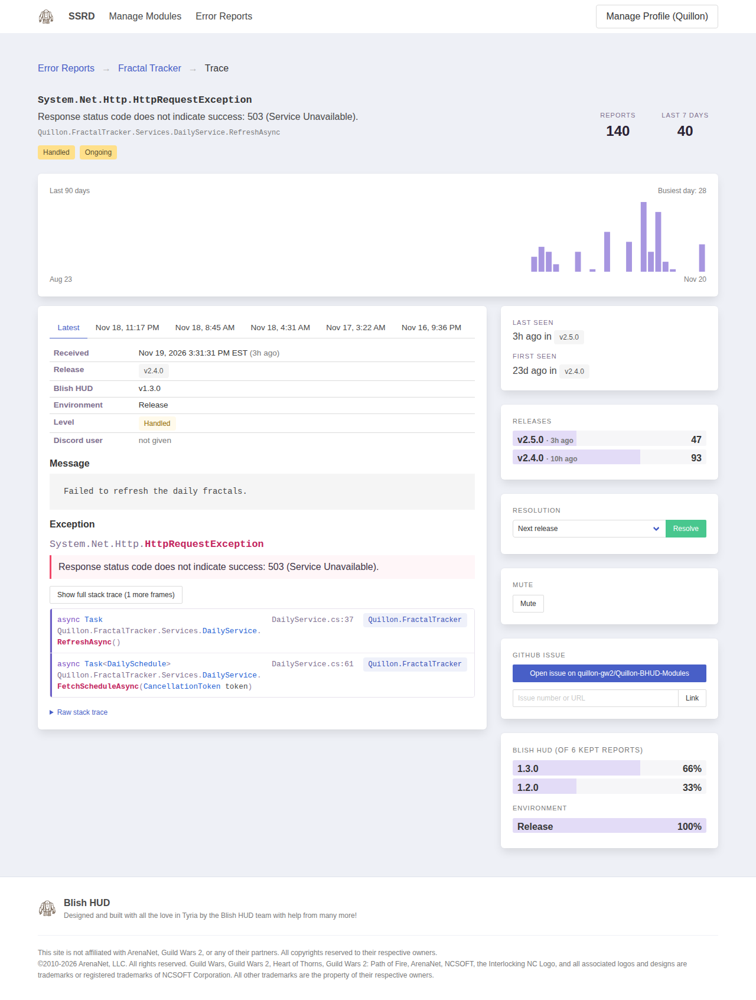

## Overview

Users who run the [Error Submission Module](https://blishhud.com/modules/?module=bh.community.etm) send SSRD a report when one of your modules throws an error. Blish HUD doesn't send reports on its own, so you only see errors from users who have that module enabled.

Reports of the same error are grouped into a trace, so you can see how often it happens and which releases it affects.

Open **Error Reports** from the navigation bar to see the traces for all of your modules, or from the **Error Reports** button on a module's **Releases** page to see one module. The crash and handled error counts on the **Modules** and **Releases** pages link there too.

Errors come in two levels:

| Level | Meaning |
| - | - |
| Crash | An unhandled exception that crashed Blish HUD. |
| Handled | An error your module caught and logged. |

Search the list, or narrow it by module, level and release. Resolved and muted traces are hidden until you choose to show them.

## Traces

Select a trace to see its exception, stack trace, the releases it was reported in, and recent samples with the Blish HUD version and environment they came from.

From a trace you can:

- **Resolve** it, choosing the release that fixes it. If it's reported again in a later release, it shows up as unresolved again.
- **Mute** it to hide it from the list without resolving it.
- **Open** a GitHub issue for it in your repository, or **Link** it to an existing issue.

:::tip
Errors logged without an exception only include the message. Pass the exception to the logger to include its stack trace in the report.
:::
