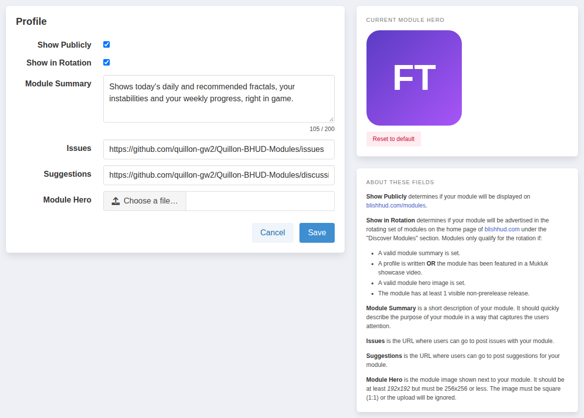
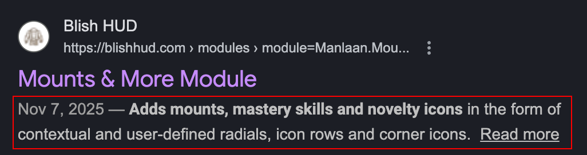
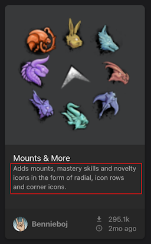
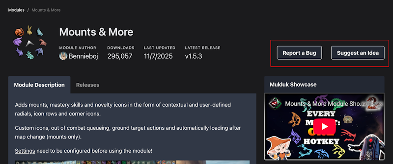
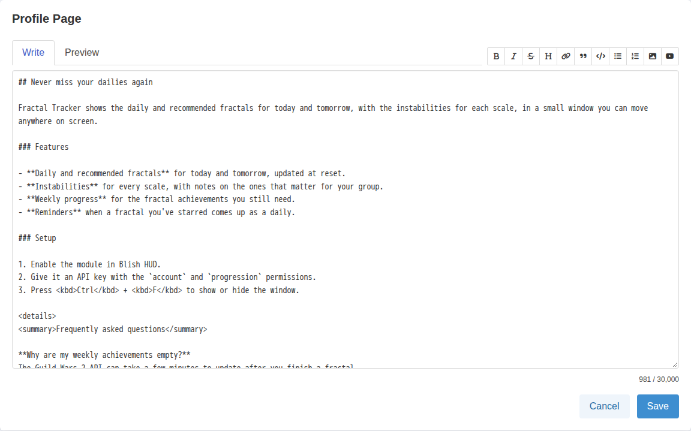

## Overview

A module's **Profile** page sets how your module is shown on https://blishhud.com/modules. Open it by selecting **Profile** next to your module on the **Modules** page. Select **See Live Profile** to view the published result.

## Show Publicly

**Show Publicly** lists your module on https://blishhud.com/modules.

## Show in Rotation

**Show in Rotation** adds your module to the rotating **Discover Modules** section on the https://blishhud.com/ home page. A module qualifies for the rotation when:

- A module summary is set.
- A profile page is written, or the module has been featured in a Mukluk showcase video.
- A module hero image is set.
- The module has at least one visible release that isn't a prerelease.

If your module doesn't qualify yet, the page lists what's missing.

## Module Summary

:::warning
This field *does not* support Markdown or any other kind of formatting. Use the **Profile Page** for anything longer.
:::

The **Module Summary** is a short description of your module, up to 200 characters. It should quickly describe the purpose of your module in a way that captures the user's attention.

It is used for:
1. The short description shown below the module image on https://blishhud.com/modules.
2. The description Google shows for your module's page.
3. The text shown on your module's page if no **Profile Page** is written.

## Issues & Suggestions

The **Issues** and **Suggestions** fields add links that users see on your module's page as **Report a Bug** and **Suggest an Idea**.

If a field is left blank, its button isn't shown. These usually point to GitHub issues or discussions, but they can go wherever you'd like to receive feedback.

## Module Hero

The **Module Hero** is the module image shown with your module. Upload a square (1:1) PNG of at least 192x192 and no more than 256x256. Select **Reset to default** to go back to the default image.

## Profile Page

The **Profile Page** is the full description shown on your module's page. Write it in Markdown in the editor at the bottom of the **Profile** page, then select **Save**.

The editor supports:
- Much of the Markdown that GitHub supports, including tables and [collapsible sections](https://docs.github.com/en/get-started/writing-on-github/working-with-advanced-formatting/organizing-information-with-collapsed-sections).
- Images and GIFs. Paste or drop them into the editor, or use the image button, and they're uploaded for you.
- YouTube videos. Use the YouTube button, or paste a link to a video on its own line, and it's embedded in your module's page.
- A **Preview** tab to check how your profile will look before you save it.

For example:
| Module | Profile |
| - | - |
| Pathing | https://blishhud.com/modules/?module=bh.community.pathing |
| Bag of Holding | https://blishhud.com/modules/?module=fs.bagofholding |
| Discord Rich Presence | https://blishhud.com/modules/?module=bh.general.discordrp |
