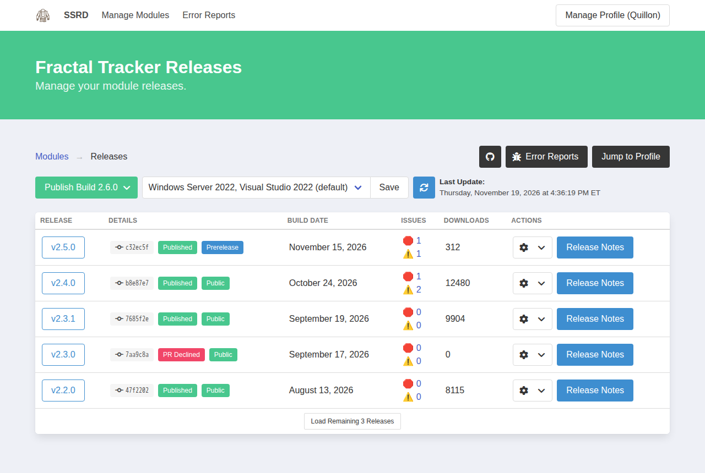
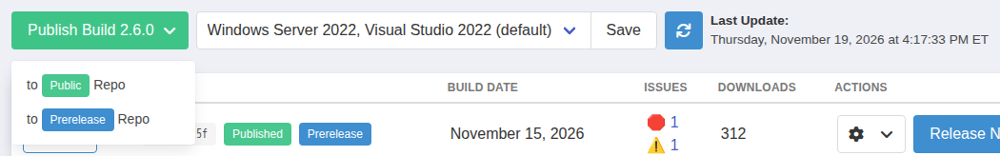
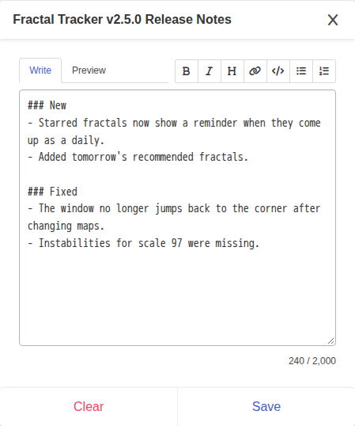
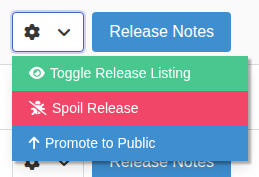

## Overview

A module's **Releases** page is where you build and publish new releases, write release notes and manage releases that already exist. Open it by selecting **Releases** next to your module on the **Modules** page.

## Publish a new release

Select **Publish Build** and choose the repository to publish to. The button shows the version from your module's manifest, so bump the version in your manifest before publishing. The button is disabled if that version has already been released.

SSRD builds your module, checks the package and opens a pull request in the chosen repository with a report for reviewers. The release appears in the table as **PR Pending**. Once the pull request is merged it changes to **Published**, and it's announced in the [🎉release-feed](https://discord.gg/ryWP5Ct89S) Discord channel and on https://blishhud.com/.

Your last few builds are listed under **Recent Builds**, with any errors or warnings and a link to the build log. Select **Try Again** to retry a failed build.

### Publish to the public repo

Releases in the public repo are visible to all users running a compatible version of Blish HUD.

### Publish to the prerelease repo

Releases in the prerelease repo are visible only to users who enable [Preview releases](https://blishhud.com/docs/user/overlay-settings#:~:text=Blish%20HUD%20window.-,Preview%20releases,-No). Use prereleases to test major changes with a smaller audience first. When a prerelease is ready, you can [promote it](#promote-to-public) to the public repo without building it again.

### Build runner

Builds run on `windows-2022` by default. If your module needs a different build image, choose it from the build runner menu next to **Publish Build** and select **Save**.

## Release status

| Status | Meaning |
| - | - |
| PR Pending | The release is built and waiting for its pull request to be reviewed. |
| Published | The pull request was merged and the release is available in Blish HUD. |
| PR Declined | The pull request was closed without being merged. |

Each release also links to the commit it was built from, and shows its downloads and [error reports](/docs/modules/ssrd/error-reports).

## Release notes

Release notes help users understand what changed in each version. They're shared in the [🎉release-feed](https://discord.gg/ryWP5Ct89S) Discord channel and on https://blishhud.com/.

Select **Release Notes** on a release to open the editor beside the table. Notes are written in Markdown, with buttons for common formatting and a **Preview** tab to check how they'll look. Select **Save** when you're done.

You can edit release notes at any time. Changes show up on the website, and the Discord announcement is updated to match.

## Release actions

Select the gear button on a release to see what you can do with it. Only the actions that apply to that release are shown.

    
Toggle Release Listing

    

        Hide a release from Blish HUD, or show it again. Hidden releases don't appear in the module repo, which can reduce clutter in the version dropdown.
    

    
Spoil Release

    

        
<strong>Only an admin can restore a spoiled release.</strong>

        

            Spoiling fully recalls a published release for all users:
            <ul>
                <li>The release can no longer be downloaded from Blish HUD's module repo.</li>
                <li>Users can't enable the module under any circumstance, even if it was previously downloaded and enabled.</li>
            </ul>
        

        
Spoil a release when it causes widespread unhandled or fatal exceptions that crash Blish HUD.

    

    
Promote to Public

    

        
<i>Available on published prereleases.</i>

        
Release a prerelease to everyone. The exact package your prerelease users tested is moved to the public repo, without building it again, and announced as a new release.

    

    
Rebuild Release

    

        
<i>Available while a release is PR Pending.</i>

        
Build the same version again from your latest commit, on the same pull request. Use it to fix a bug you find before the release is merged, without bumping the version. Your manifest must still be at that version.

    

    
Delete Release

    

        
<i>Available while a release is PR Pending or PR Declined.</i>

        
Remove the release from SSRD, closing its pull request if it's still open.

    

