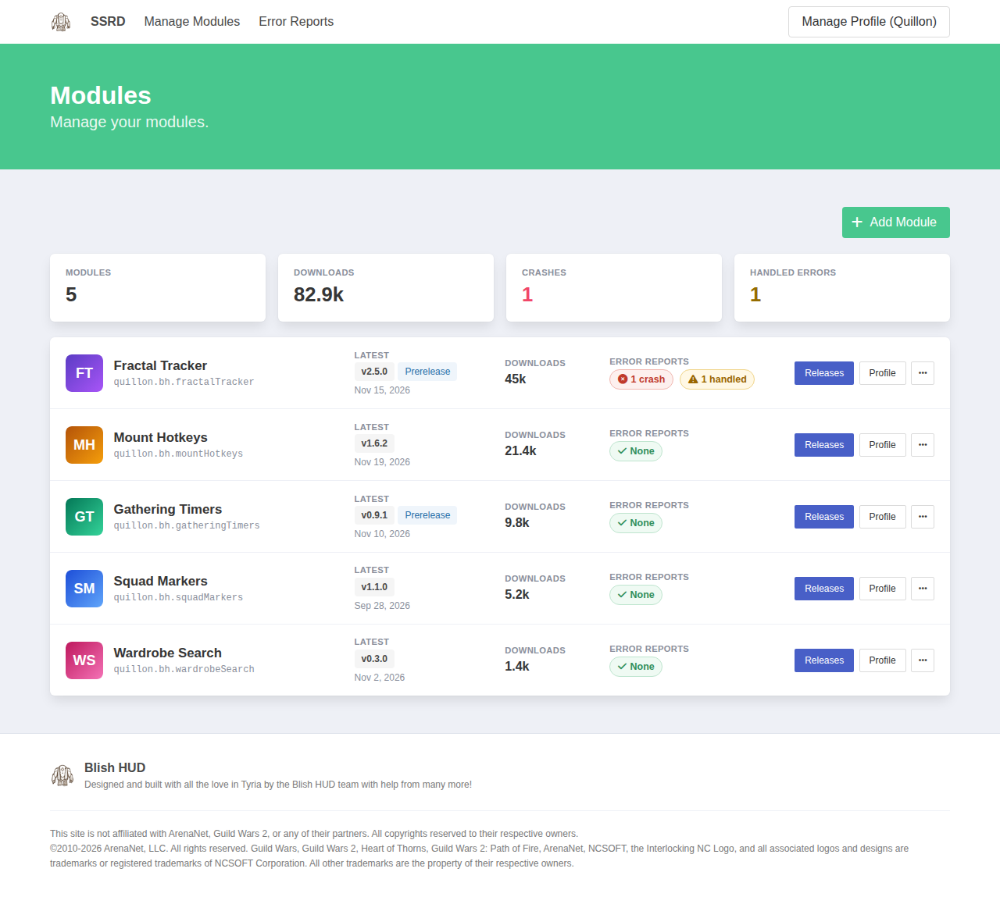

# SSRD

SSRD (Self-Service Request Dashboard) is where module developers manage their modules. From SSRD you can:

- [Register modules](/docs/modules/ssrd/registering-modules) from a GitHub repository, public or private.
- [Build and publish releases](/docs/modules/ssrd/manage-releases) to the public or prerelease repo, and write their release notes.
- [Write your module's profile](/docs/modules/ssrd/manage-profile) for https://blishhud.com/modules.
- [Review error reports](/docs/modules/ssrd/error-reports) sent by Blish HUD users running your modules.
- [Set up your author profile](/docs/modules/ssrd/author-profile) and release webhooks.
- [Host static files](/docs/modules/ssrd/additional-services) for your modules.

Your modules are listed on the **Modules** page, with their latest version, downloads and error reports.

:::info Want Access?
Module developers need a contributor account to sign in to SSRD.

Please reach out to Freesnöw on Discord to request access.
:::
