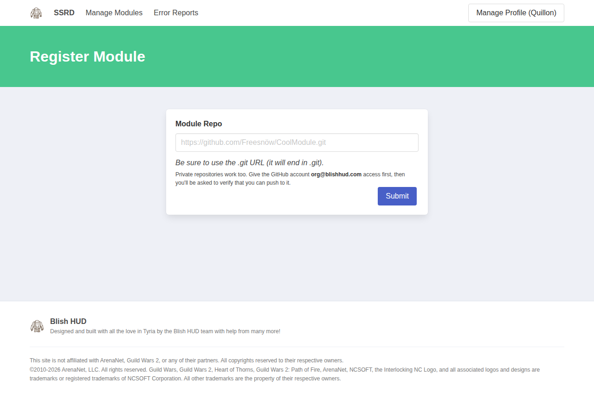
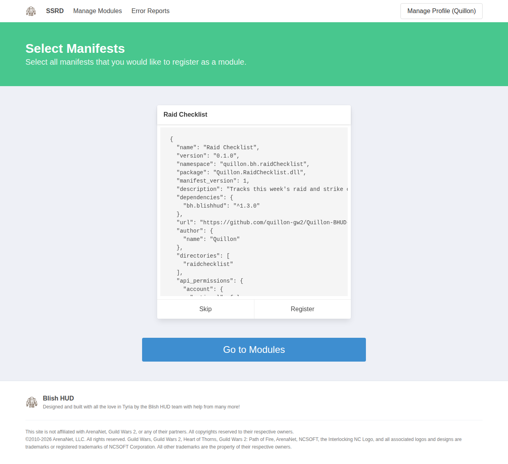
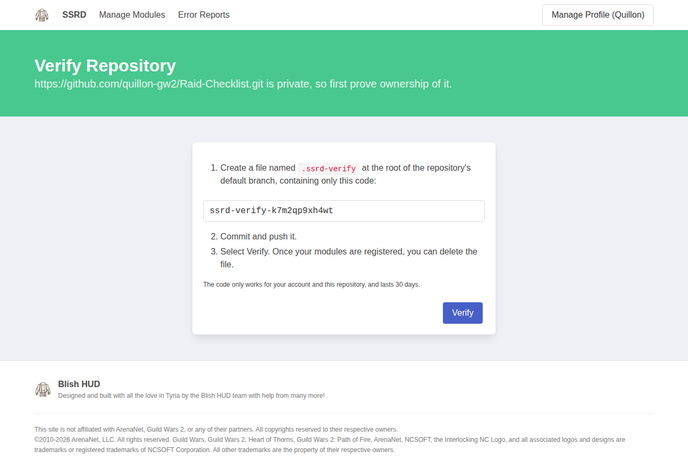

## Overview

Modules are registered by their Git URI. A single repository can contain multiple modules, and SSRD finds each one for you.

## Registering a module

#### 1. Copy the Git URI from your repository
On GitHub, open the **Code** menu and copy the HTTPS URI. It ends in `.git`.

#### 2. Submit it on the Register Module page
On the **Modules** page, select **Add Module**, paste the URI into **Module Repo** and select **Submit**.

#### 3. Register the modules you want
SSRD shows the manifest of each module it found in the repository. Select **Register** on each module you want to manage, or **Skip** to leave it out. When you're done, select **Go to Modules**.

## Private repositories

Private repositories can be registered too:

1. Give our `org@blishhud.com` GitHub account read access to your repository.
2. Submit the repository's Git URI as usual.
3. SSRD asks you to prove you can push to the repository. Create a file named `.ssrd-verify` at the root of the default branch containing the code shown, then commit and push it.
4. Select **Verify**. Once your modules are registered, you can delete the file.

The code only works for your account and that repository, and lasts 30 days.

## Keeping manifests up to date

SSRD watches your repository and picks up new pushes on its own, usually within about 10 minutes. If your repository has multiple modules, all of them are updated.

To pick up a push right away, select the refresh button on your module's **Releases** page. The time next to it shows when the manifest was last updated.

## Remarks

- SSRD works best with modules hosted on GitHub. Repositories on other Git hosts can be registered too, but some features may be limited and support for them is not guaranteed.
- Everything your module needs to build must be in the same repository. If your module depends on a project outside the repo, either include the shared library DLL in the module repo or publish it as a NuGet package.
- If something unexpected happens, please let Freesnöw know so it can be looked into.
